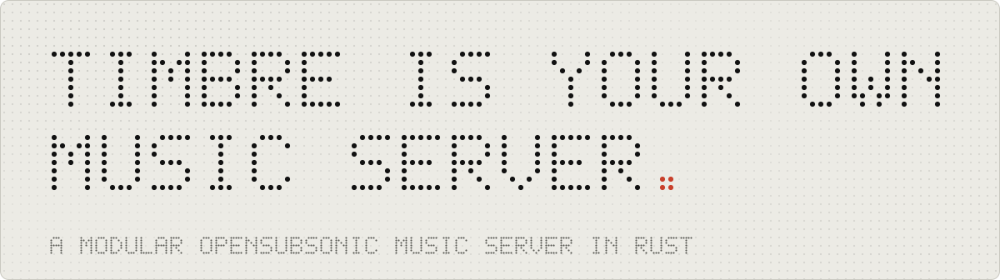

<picture>
  <source media="(prefers-color-scheme: dark)" srcset="docs/readme/header-dark.svg">
  
</picture>

Point Timbre at the music on your computer or NAS and listen through the apps you already use:
[Symfonium](https://symfonium.app), [Feishin](https://github.com/jeffvli/feishin),
[Amperfy](https://github.com/BLeeEZ/amperfy) and anything else that speaks
[OpenSubsonic](https://opensubsonic.netlify.app). Every feature is a module you can pull out, and the server keeps
running without it.

> **Not ready to play music yet.** The core, the library scanner, the folder view, user accounts with per-device
> keys, listening activity and playlists are built; streaming and the OpenSubsonic API come next. Follow the progress
> at [timbre.page](https://timbre.page).

## Modules

<picture>
  <source media="(prefers-color-scheme: dark)" srcset="https://timbre.page/assets/readme/bank-dark.svg">
  
</picture>

Each module is a crate that registers with the kernel and talks to the others only through signals and ports the
kernel defines. Removing one is a single command, and CI builds the server with each module left out.

```sh
cargo xtask module new radio      # creates crates/modules/radio and connects it
cargo xtask module remove radio   # takes it out again
```

## What runs today

```sh
cargo build --release
./target/release/timbre scan                       # read the folders in timbre.toml into the library
./target/release/timbre library explain <file>     # why a track landed in its album
./target/release/timbre user add anuar --admin     # a user, with every permission
./target/release/timbre device issue anuar phone   # a key for one device, printed once
./target/release/timbre audit --since 2026-11-01   # the security journal: refusals, users and keys
./target/release/timbre serve                      # the server, with no protocol modules yet
```

Device keys are stored only as SHA-256 digests. Failed logins are throttled per address and per user, and every
refused login, denied request and user or key change lands in the journal for a year.

A minimal `timbre.toml`:

```toml
[library]
roots = ["/srv/music"]
```

On a 36,034-track library a first scan takes 62 seconds with the files already in the OS cache (6.5 minutes cold
from a hard disk), a rescan with no changes 0.6 seconds, and the idle server holds about 15 MB.

## Building

Rust 1.100 (pinned in `rust-toolchain.toml`) and a C compiler for the bundled SQLite. `just ci` runs every check CI
runs. Contributors and coding agents start at [AGENTS.md](AGENTS.md).

## License

[AGPL-3.0](LICENSE). Questions or ideas: me@lunateque.com.
